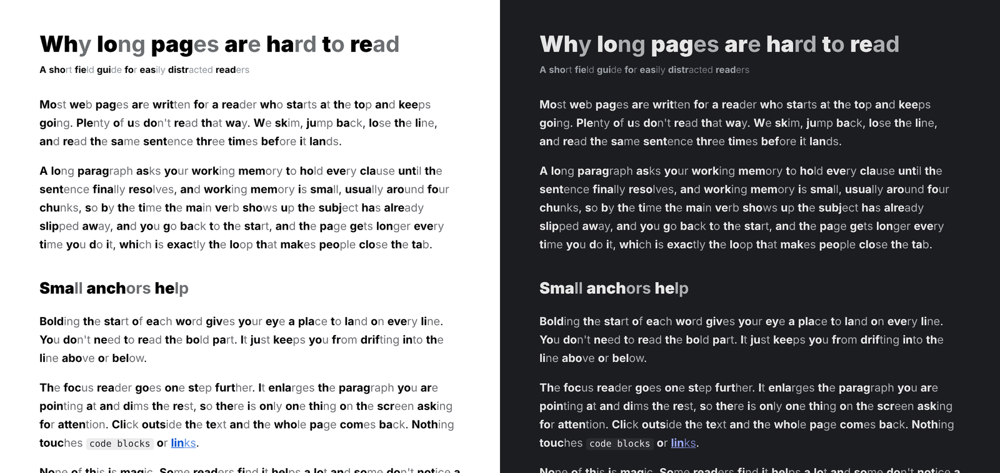
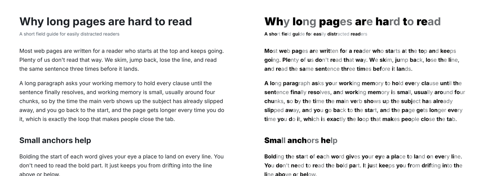
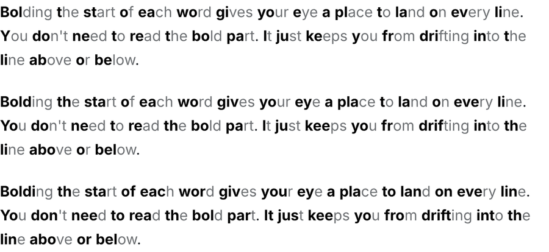
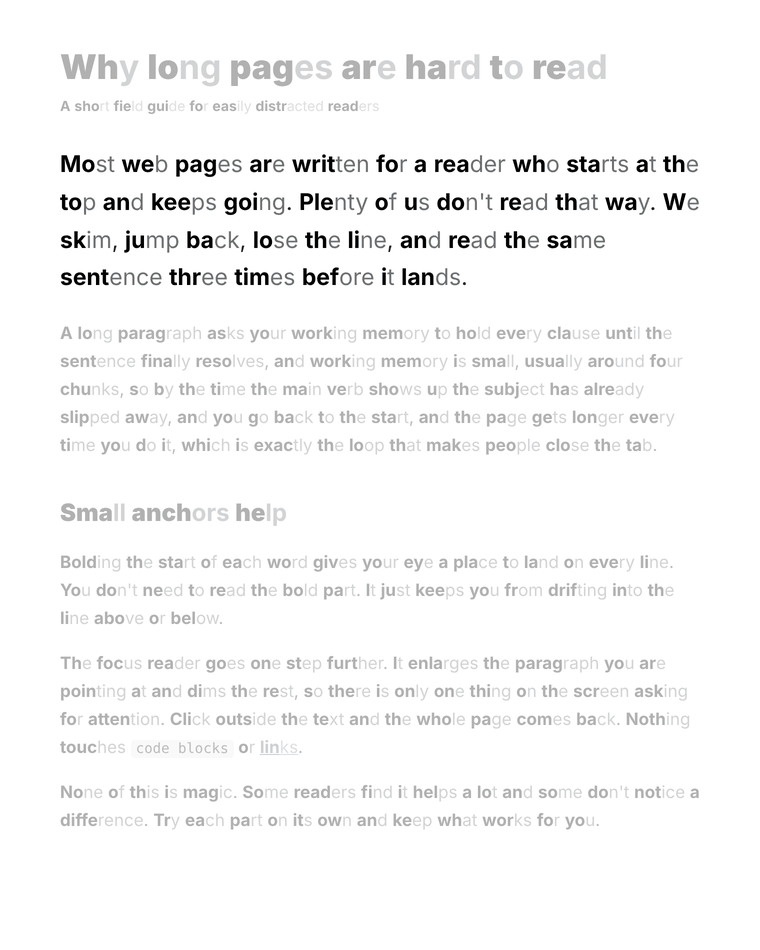
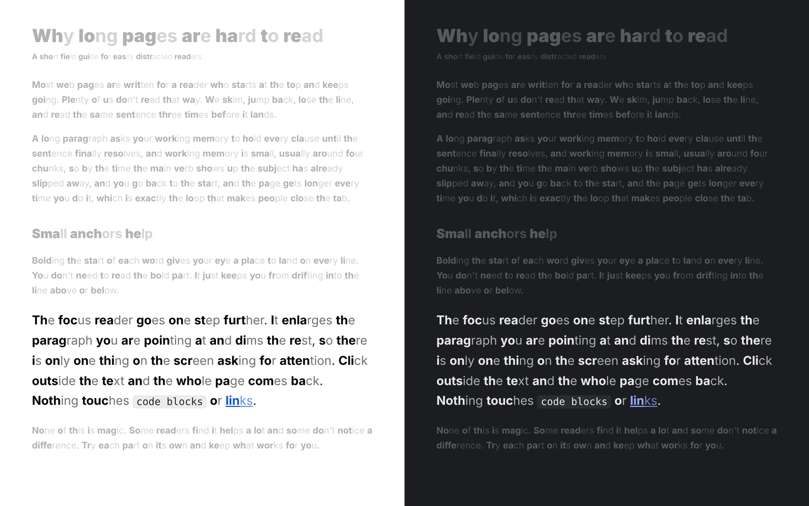
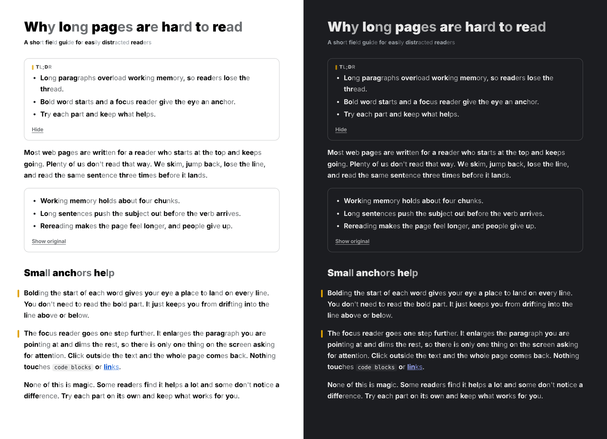
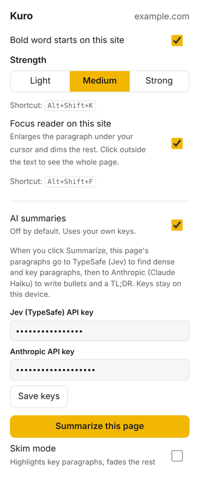
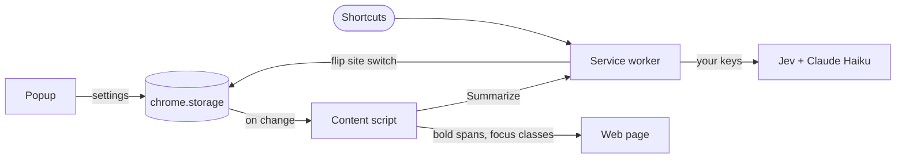

# Kuro

A Chrome extension that makes long web pages easier to read, built by and for people with ADHD.

*Kuro (黒) is Japanese for "black", as in bold ink.*

It bolds the start of every word so your eyes always have somewhere to land, enlarges the paragraph you are reading while the rest of the page steps back, and (if you want) uses AI to turn dense walls of text into short bullets.



- **Bold word starts.** Strong, obvious anchors on every word, tuned separately for light and dark pages.
- **Focus reader.** The paragraph under your cursor grows and everything else dims. Click outside the text to see the whole page again.
- **Off until you want it.** Bolding and the focus reader are separate switches per site, and every site starts with both off.
- **AI summaries (optional).** A TL;DR at the top, dense paragraphs turned into bullets, and margin marks on the paragraphs that carry the argument. Uses your own API keys.
- **Doesn't break pages.** Code blocks, form fields and editable areas are left alone, so Gmail drafts, Google Docs and code editors keep working. Turning it off restores the page exactly.

## Contents

- [What it looks like](#what-it-looks-like)
- [Install](#install)
- [Shortcuts](#shortcuts)
- [Using it](#using-it)
- [AI summaries](#ai-summaries)
- [Privacy](#privacy)
- [Cost](#cost)
- [How it works](#how-it-works)
- [Develop](#develop)
- [A note on evidence](#a-note-on-evidence)

## What it looks like

### Bold word starts

The first part of each word is bolded. You don't read the bold part on purpose. It just keeps your eye from sliding into the line above or below.



Kuro reads the page's text color and adapts:

| Page | Word starts | Rest of the word |
|---|---|---|
| Light (dark text) | Pure black, bold | Faded to 65% |
| Dark (light text) | Bold, in the page's own color | Faded to 72% |

Links and colored text keep their own color. Starts inside headings and bold text go extra heavy so they still stand out. If a site switches between light and dark while you are on it, Kuro re-checks and follows.

There are three strengths. They set how much of each word is bold:



| Strength | Share of each word bolded |
|---|---|
| Light | 30% |
| Medium (default) | 45% |
| Strong | 60% |

At least one letter is always bolded. Words in scripts written without spaces, such as Chinese, Japanese or Thai, are left alone.

### Focus reader

Point at a paragraph and it grows to 1.35x while the rest of the page dims. The page scrolls to keep that paragraph where it was, so nothing jumps out from under your cursor. Click anywhere that isn't text and the whole page comes back until you point at a paragraph again.





### AI summaries and margin marks

After you click **Summarize this page**, Kuro adds a TL;DR at the top, swaps each dense paragraph for a few bullets (with **Show original** to get it back), and puts a short amber mark in the margin beside the paragraphs that carry the argument. The boxes are a thin outline in the page's own text color, so they fit on any site.



### Popup



## Install

Kuro isn't on the Chrome Web Store yet. Load it from source:

1. Install [Node.js](https://nodejs.org) 22.18 or newer.
2. Clone this repo, then in the folder run:
   ```sh
   npm install
   npm run build
   ```
   If npm says esbuild's install script is blocked, run `npm install-scripts approve esbuild` and build again.
3. Open `chrome://extensions`, turn on **Developer mode**, click **Load unpacked**, and pick the `dist` folder.
4. Pin Kuro from the puzzle-piece menu.

It should also work in other Chromium browsers that load unpacked extensions, such as Edge, Brave and Arc, though it is only tested in Chrome.

**Updating:** pull, run `npm run build`, then click the reload icon on Kuro in `chrome://extensions`. If the shortcuts changed, remove Kuro and load it again, because Chrome only applies new default shortcuts on a fresh install.

## Shortcuts

| Action | Mac | Windows and Linux |
|---|---|---|
| Bold word starts on or off for this site | <kbd>Control</kbd>+<kbd>Shift</kbd>+<kbd>B</kbd> | <kbd>Alt</kbd>+<kbd>Shift</kbd>+<kbd>K</kbd> |
| Focus reader on or off for this site | <kbd>Control</kbd>+<kbd>Shift</kbd>+<kbd>F</kbd> | <kbd>Alt</kbd>+<kbd>Shift</kbd>+<kbd>F</kbd> |

On a Mac this is the real Control key, not Command. Command+Shift+B is taken by Chrome's bookmarks bar, and on Windows and Linux Chrome keeps Alt+Shift+B for itself.

The popup shows the shortcuts Chrome actually assigned. If one says "none", another extension already uses that key. Pick your own at `chrome://extensions/shortcuts`.

## Using it

1. Open an article and press the bolding shortcut, or open the popup and switch on **Bold word starts on this site**.
2. Want the focus reader too? Press its shortcut or switch on **Focus reader on this site**. It works with or without bolding.
3. Pick a strength in the popup. It applies on every site where bolding is on.
4. Kuro remembers your choice per site (`docs.python.org` and `python.org` count as different sites) and syncs settings across your Chrome profile.

New content that loads as you scroll gets bolded too.

## AI summaries

AI is off until you turn it on in the popup. It needs two keys, which you paste into the popup.

| Step | Service | What it does | Key |
|---|---|---|---|
| 1 | [TypeSafe](https://typesafe.ai) Jev | Rates each paragraph: how dense it is, and whether it is key to the argument. | Jev API key |
| 2 | [Anthropic](https://console.anthropic.com) Claude Haiku 5.5 | Writes the TL;DR and turns only the dense paragraphs into bullets. | Anthropic API key |

Click **Summarize this page** to run it. It usually takes 10 to 30 seconds. A paragraph counts as dense when Jev rates it 0.6 or higher and it has at least 35 words. Turn on **Skim mode** to fade everything except the key paragraphs.

## Privacy

- Kuro has no server and no analytics. Nothing ever goes to the Kuro author.
- Bolding and the focus reader run entirely in your browser.
- AI runs only when you click **Summarize this page**. Then the page's paragraph text is sent to TypeSafe and to Anthropic, and nowhere else. Don't run it on pages with private information you don't want to share with those services.
- Your API keys are stored only in this browser (`chrome.storage.local`, not synced) and are sent only to the service they belong to. The calls are made from the extension's service worker, so web pages never see your keys.
- Settings (which sites are on, strength) sync through your Chrome profile and contain no page content.

## Cost

Bolding and the focus reader are free. For AI you pay each service directly with your own key:

| Service | Price (Oct 2026) |
|---|---|
| Claude Haiku 5.5 | $0.10 per million input tokens, $0.50 per million output tokens |
| Jev | $0.042 per million input tokens |

A typical long article is a few thousand tokens, so summarizing one costs well under a cent.

## How it works



The content script wraps each word's start in a `<b>` and the rest in a `<span>`, in small batches so huge pages stay responsive. Turning it off unwraps everything and merges the text back. See [docs/architecture.md](docs/architecture.md) for the full picture.

## Develop

```sh
npm run watch      # rebuild dist/ on every change
npm test           # unit tests (node --test)
npm run typecheck  # tsc --noEmit
npm run build      # production build into dist/
```

After a rebuild, click the reload icon on Kuro in `chrome://extensions`.

| Path | What's there |
|---|---|
| `src/bold.ts` | How much of each word to bold. Pure logic, unit tested. |
| `src/content.ts`, `content.css` | Bolding, focus reader, AI results on the page |
| `src/background.ts` | Shortcuts and all network calls |
| `src/popup.ts`, `popup.html` | The popup |
| `src/ai/` | Jev triage, Haiku summaries, orchestration |

## A note on evidence

Research on bolded word starts is thin and mostly anecdotal. Some people find it helps a lot, and some don't notice a difference. The focus reader and the bullet summaries are there for a different problem: losing your place and getting stuck on dense paragraphs. Try each part on its own and keep what works for you.

## License

[MIT](LICENSE)
