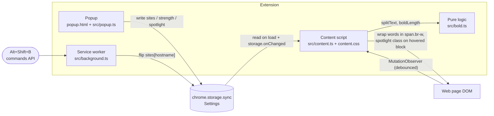

# Architecture

BoldRead is a Manifest V3 Chrome extension. It has three runtime parts and one shared settings store. v1 has no network calls.



## Parts

| Part | File | Job |
|---|---|---|
| Popup | `popup.html`, `src/popup.ts`, `popup.css` | Site on/off, strength, spotlight. Writes settings only. |
| Service worker | `src/background.ts` | Handles the Alt+Shift+B command and flips the current site. |
| Content script | `src/content.ts`, `content.css` | Reads settings, bolds text nodes, runs the spotlight, reverts cleanly. |
| Pure logic | `src/bold.ts` | `boldLength(word, strength)` and `splitText(text)`. No DOM, unit tested with `node --test`. |

## Settings

```ts
type Settings = {
  sites: Record<string, boolean>; // key: location.hostname
  strength: "light" | "medium" | "strong"; // 0.3, 0.45, 0.6 of each word, round up, min 1 letter
  spotlight: boolean;
};
```

## Content script rules

- Skip `SCRIPT`, `STYLE`, `NOSCRIPT`, `TEXTAREA`, `INPUT`, `CODE`, `PRE`, `SVG`, and any `contenteditable` subtree.
- Wrap processed text in `span.br-w`. Turning off replaces each span with its plain text.
- A debounced `MutationObserver` handles new content. It is disconnected while the script itself edits the DOM.
- On very large pages, process text nodes in batches with `requestIdleCallback`.

## Build

`npm run build` (esbuild) bundles each `src/*.ts` entry to `dist/` as an IIFE and copies `manifest.json`, `content.css`, `popup.html` and `popup.css`. Load `dist/` with "Load unpacked".
