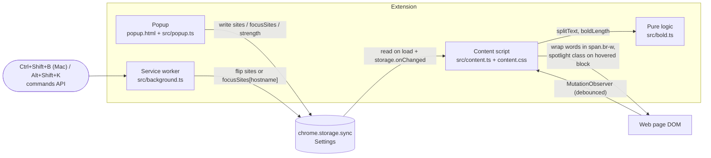

# Architecture

BoldRead is a Manifest V3 Chrome extension. It has three runtime parts and one shared settings store. Network calls happen only when the user clicks Summarize, and only from the service worker.



## Parts

| Part | File | Job |
|---|---|---|
| Popup | `popup.html`, `src/popup.ts`, `popup.css` | Bolding and focus reader per site, strength. Writes settings only. |
| Service worker | `src/background.ts` | Handles both shortcuts (bolding: Control+Shift+B on Mac, Alt+Shift+K elsewhere; focus reader: Control+Shift+F / Alt+Shift+F) and flips the setting for the current site. |
| Content script | `src/content.ts`, `content.css` | Reads settings, bolds text nodes, runs the spotlight, reverts cleanly. |
| Pure logic | `src/bold.ts` | `boldLength(word, strength)` and `splitText(text)`. No DOM, unit tested with `node --test`. |
| AI | `src/ai/*.ts` | Jev triage (`jev.ts`), Haiku bullets and TL;DR (`summarize.ts`), orchestration (`analyze.ts`). Unit tested with fakes. |

## AI flow (opt-in, bring your own keys)

```mermaid
sequenceDiagram
  participant U as User
  participant P as Popup
  participant C as Content script
  participant B as Service worker
  participant J as Jev (api.typesafe.ai)
  participant H as Claude Haiku 5.5 (api.anthropic.com)
  U->>P: Summarize this page
  P->>C: br-run-analysis
  C->>C: pick main content, collect leaf paragraphs (>= 12 words)
  C->>B: br-analyze {title, paragraphs}
  B->>B: read keys from chrome.storage.local
  par one request per paragraph, 4 at a time
    B->>J: score "density" + noul "key"
  end
  B->>B: dense = density >= 0.6 and >= 35 words, key = noul >= 0.6
  B->>H: all paragraphs + dense ids (structured JSON output)
  H-->>B: {tldr[], chunks[{id, bullets[]}]}
  B-->>C: Analysis
  C->>C: TL;DR box, bullets replace dense paragraphs, mark key paragraphs
```

- Keys live in `chrome.storage.local` (this device only), never in `sync` and never in the page.
- Calls run in the service worker. `host_permissions` for both APIs means no CORS preflight issues. The Anthropic SDK runs with `dangerouslyAllowBrowser: true`, which sends the `anthropic-dangerous-direct-browser-access` header the API requires for browser-origin requests. The key is the user's own, so this is the intended use.
- If one Jev call fails, that paragraph is treated as unrated. If every call fails, the error is shown in the popup.
- Main content: `article`, `main` or `[role=main]` with the most text, else `body`. `@mozilla/readability` was considered, but it works on a copy of the page, which makes it hard to map results back to live paragraphs.

## Settings

```ts
type Settings = {
  sites: Record<string, boolean>;      // bold word starts, key: location.hostname, off unless true
  focusSites: Record<string, boolean>; // focus reader, same keys, separate switch
  strength: "light" | "medium" | "strong"; // 0.3, 0.45, 0.6 of each word, round up, min 1 letter
  skim: boolean;     // fade non-key paragraphs after an AI pass
  aiEnabled: boolean; // off by default
};
// API keys: chrome.storage.local { jevKey, anthropicKey }
```

## Content script rules

- Skip `SCRIPT`, `STYLE`, `NOSCRIPT`, `TEXTAREA`, `INPUT`, `CODE`, `PRE`, `SVG`, and any `contenteditable` subtree.
- Wrap processed text in `span.br-w`. Turning off replaces each span with its plain text.
- A debounced `MutationObserver` handles new content. It is disconnected while the script itself edits the DOM.
- On very large pages, process text nodes in batches with `requestIdleCallback`.

## Build

`npm run build` (esbuild) bundles each `src/*.ts` entry to `dist/` as an IIFE and copies `manifest.json`, `content.css`, `popup.html` and `popup.css`. Load `dist/` with "Load unpacked".
